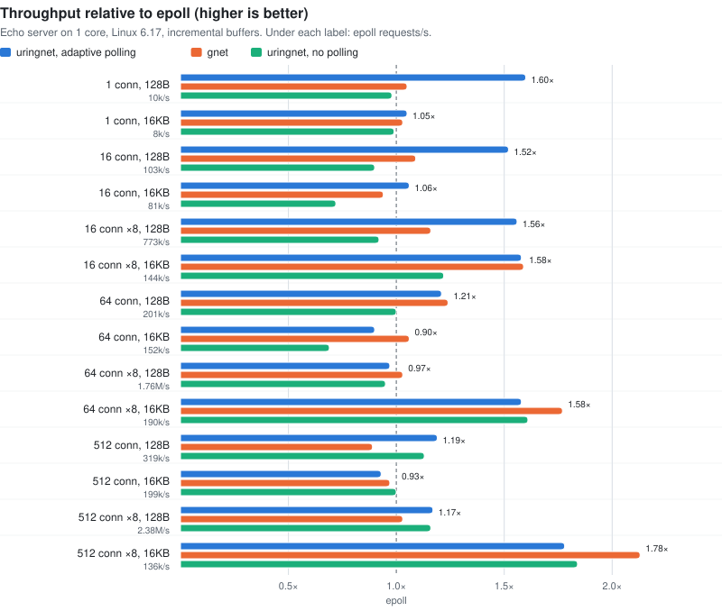
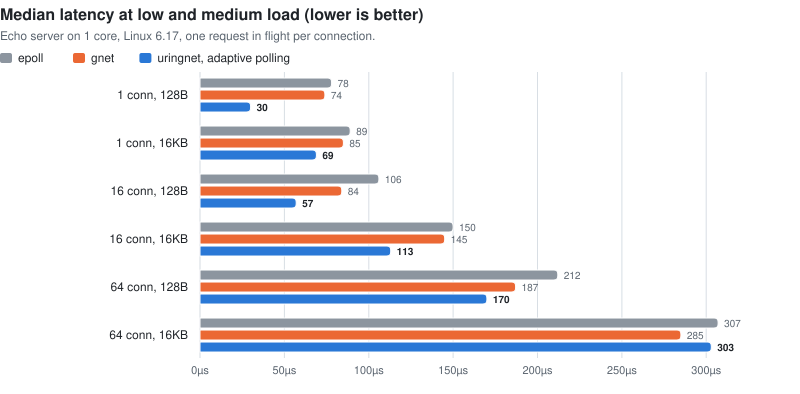

# UringNet

[](https://github.com/y001j/uringnet/actions/workflows/go.yml)
[](https://pkg.go.dev/github.com/y001j/uringnet)
[](go.mod)
[](LICENSE)

## Introduction

### Why I created this 

UringNet is a lightweight network I/O framework written in Go, built on [io_uring](https://kernel.dk/io_uring.pdf), the asynchronous I/O interface Linux added in 5.1 (2019). It comes from experimental projects in my edge computing and IoT research: I wanted a simple but fast way to move network packets in IoT gateways, tried select/epoll first, and then io_uring.

Measured against a hand-written epoll loop and [gnet](https://github.com/panjf2000/gnet) on Linux 6.17, with the recommended
configuration (incremental buffers + adaptive busy polling; see [Benchmark](#benchmark)):

- **Low load** (1–16 connections): 1.5–1.6x the throughput of epoll for small messages, and the median latency drops from
  ~78µs to ~30µs. The cost is CPU: about twice the server CPU at the lowest load.
- **Many connections, small messages** (512 connections, 128B): 1.17–1.19x of epoll, 14–34% ahead of gnet.
- **16KB messages under medium and high load**: gnet stays ahead by 12–20% (bulk pipelined: 1.58–1.78x of epoll vs 1.77–2.13x).
- Overall, of 14 scenarios uringnet is more than 10% ahead of gnet in 6, within ±10% in 5 and behind in 3.
- On an older kernel (6.10) without busy polling, uringnet is mostly 10–30% behind epoll.

What io_uring brings is far fewer system calls (under load as few as 0.04 per request, versus 2–3 for epoll), batched submission, and
zero-copy send for large buffers. The gains depend heavily on the workload and the machine, so measure with your own traffic.

#### How io_uring works


The application and the kernel share two ring buffers in memory mapped into both. The application writes requests (SQEs) at the
tail of the submission queue and the kernel takes them from its head; the kernel writes results (CQEs) at the tail of the
completion queue and the application takes them from its head. Neither step is a system call: a single `io_uring_enter`
submits a whole batch of requests and waits for a batch of results.

### Should You adopt it in your project

UringNet was designed for IoT gateways: many connections, small messages, request/response traffic. It provides TCP and Unix
stream sockets (no UDP or TLS yet). Consider it if:

- you run Linux 6.0+ (6.16+ for recv bundles) and io_uring is allowed on the host (it is blocked by Docker's and Kubernetes'
  default seccomp profiles), and
- latency or system-call overhead matters to you, and you can spare some CPU for busy polling.

Otherwise, more mature options such as Go [net](https://golang.org/pkg/net/)/[http](https://pkg.go.dev/net/http),
[gnet](https://github.com/panjf2000/gnet), [netty](https://netty.io/) or [libuv](https://github.com/libuv/libuv) are a safer
choice. They run on more platforms and kernels, and have been in production for years.

## Get Started

UringNet extensively references existing network frameworks such as gnet and Netty, with some usage patterns closely resembling those of gnet. Please note that UringNet is based on io_uring and, therefore, requires running on the Linux operating system with a kernel version **6.0 or later** (multishot recv / provided buffer ring; 6.1+ additionally enables `SINGLE_ISSUER | DEFER_TASKRUN`).

Since this version the event loop is built on the `Loop` API of [iouring-go](https://github.com/y001j/iouring-go): one io_uring and one locked OS thread per ring, multishot accept/recv, a provided buffer ring, and a single `io_uring_enter` per loop iteration.

### Install UringNet:

```shell
go get -u github.com/y001j/uringnet
```

### echo server example

```go
package main

import (
	"os"
	"os/signal"
	"runtime"
	"syscall"

	"github.com/y001j/uringnet"
	socket "github.com/y001j/uringnet/sockets"
)

type echoServer struct {
	uringnet.BuiltinEventEngine
}

// OnTraffic runs on the ring's event-loop thread every time data arrives.
// data.Buffer is only valid during the callback; WriteBuf is copied (or sent
// zero-copy when it points into data.Buffer).
func (es *echoServer) OnTraffic(data *uringnet.UserData, ringnet *uringnet.URingNet) uringnet.Action {
	data.WriteBuf = data.Buffer
	return uringnet.Echo
}

func main() {
	options := socket.SocketOptions{TCPNoDelay: socket.TCPNoDelay, ReusePort: true}
	ringNets, err := uringnet.NewMany(uringnet.NetAddress{AddrType: socket.Tcp4, Address: os.Args[1]},
		4096, false, runtime.NumCPU(), options, &echoServer{})
	if err != nil {
		panic(err)
	}
	loop, err := uringnet.SetLoops(ringNets, 256) // 256 receive buffers per ring
	if err != nil {
		panic(err)
	}
	loop.RunMany()

	sig := make(chan os.Signal, 1)
	signal.Notify(sig, syscall.SIGINT, syscall.SIGTERM)
	go func() { <-sig; loop.Shutdown() }()
	loop.Wait()
}
```

### Important APIs

| API | Description |
|---|---|
| `NewMany(addr, size, sqpoll, num, options, handler)` | create `num` rings; with `ReusePort` each ring gets its own listening socket. `sqpoll` is deprecated and ignored. Only stream protocols (tcp/tcp4/tcp6/unix) are supported. |
| `URingNet.BufferSize` | size of one receive buffer, set before `SetLoops` (default 16KB) |
| `URingNet.SpinTime` | busy-poll before blocking (e.g. `50*time.Microsecond`): lower latency at the cost of CPU. Adaptive by default: it stops when the loop is busy |
| `URingNet.SpinBusyBatch` / `SpinIdleBatch` | adaptive polling thresholds: stop polling at this average batch size per loop iteration, resume below the other (defaults 128 / 64) |
| `URingNet.SpinFixed` | always poll, even under full load |
| `URingNet.ZeroCopyThreshold` | enable zero-copy send (`IORING_OP_SEND_ZC`) for writes of at least this many bytes; 0 disables |
| `URingNet.RecvBundle` | recv bundles: one completion can carry several receive buffers. `BundleAuto` (default) enables them on Linux 6.16+ only; see below |
| `URingNet.IncrementalBuffers` | **experimental**: incremental buffer ring (Linux 6.12+), best with `BufferSize` 64KB and 32+ buffers; see below |
| `SetLoops(rings, bufferCount)` | create the event loops; `bufferCount` (receive buffers per ring) is rounded up to a power of 2 (max 32768). See *Sizing receive buffers* below |
| `UserData.WriteNoCopy(b, release)` | queue `b` without copying; `release` is called once the kernel no longer uses it |
| `Ringloop.RunMany()` / `Wait()` / `Shutdown()` | start accepting / block until shut down / close all connections and loops |
| `URingNet.Post(fn)` | run `fn` on the ring's event-loop thread (from any goroutine) |

Callback semantics:

- All callbacks except `OnTick` run on the ring's event-loop thread and must not block.
- `UserData` is per connection and lives for the whole connection; use `UserData.Context` for per-connection state.
- Actions: `Echo`/`Write` send `WriteBuf`; `EchoAndClose` sends then closes; `Close` closes; `Shutdown` shuts down the engine; `None`/`Read` do nothing (receiving is always active).
- Writes on one connection are ordered; short writes are handled. Everything queued during one callback is sent together
  after it returns, and separate segments (for example `WriteNoCopy` data plus a `WriteBuf` header) go out in one `sendmsg`.
- `OnClose` is called exactly once per connection, including peer close, errors and `Shutdown`.

### Sizing receive buffers

Each ring receives into a pool of `bufferCount` buffers of `BufferSize` bytes (a provided buffer ring).

- **Not fewer than the connections that are active at the same time on one ring.** When the pool runs dry, the kernel ends
  the connection's multishot recv with `-ENOBUFS` and it has to be re-armed, which costs far more than a copy.
- **Otherwise as few as possible.** The kernel uses the buffers in FIFO order, so the whole pool is the working set.
  A smaller pool keeps the memory the kernel copies into warm in the CPU cache. In the benchmark, 16KB messages with
  8 requests in flight per connection ran about 1.5x faster with 64 buffers than with 1024.
- `256` (the examples' value) is a reasonable default. Use more for many busy connections per ring, fewer for a few
  connections with bulk transfers.

### Recv bundles

With `IORING_RECVSEND_BUNDLE` one multishot recv completion can fill several consecutive receive buffers, so data that
piled up in the socket costs one completion instead of one per buffer. Each buffer is still passed to `OnTraffic`
separately. In the benchmark on Linux 6.17, bundles improved pipelined 16KB echo by 6–13%.

Kernels 6.10–6.15 have bugs that can leave **gaps in the received data** when bundles are used (fixed upstream by
`3a08988123c8` in 6.15 and `26ec15e4b0c1`/`178b8ff66ff8` in 6.16, all tagged for stable). We reproduced the corruption
on 6.10 and verified correct data on 6.17. Therefore `BundleAuto` only enables bundles on 6.16+. `BundleOn` forces them
(only if you know your kernel has the fixes), and `BundleOff` disables them.

### Incremental buffers (experimental)

`IncrementalBuffers = true` registers the receive ring with `IOU_PBUF_RING_INC` (Linux 6.12+). Instead of using one whole buffer
per receive, the kernel appends each receive after the previous data in the same buffer, so a few large buffers are packed
with data from many connections. Each in-place send references a slice of a buffer; a buffer goes back to the kernel once
the kernel has finished filling it and no slice is referenced. Because a referenced buffer can still receive data, one
connection can send several received slices in place, which avoids most user-space copies.

```go
for _, rn := range ringNets {
	rn.IncrementalBuffers = true
	rn.BufferSize = 64 << 10
}
loop, err := uringnet.SetLoops(ringNets, 32) // 32 x 64KB per ring
```

- In the Linux 6.17 benchmark this was the fastest uringnet configuration: ahead of gnet with 512 connections (small messages
  by ~15%), and within 5–10% of gnet for bulk pipelined transfers (see [Benchmark](#benchmark)).
- Use at least 32 buffers: with 16 buffers, 512 connections sending 16KB each ran out of buffers and slowed down.
- Recv bundles are not used in this mode. On kernels without support it falls back to the normal buffer ring.
- It is new code and off by default; validate it with your own traffic before enabling it in production.

### Zero-copy send

With `ZeroCopyThreshold > 0` the receive buffer ring is also registered as an io_uring *fixed buffer*
(`IORING_REGISTER_BUFFERS`). That one memory region is shared by user space and the kernel:

```
          kernel receives into it            kernel transmits from it
 NIC/TCP ───────────────────────►  buffer ring (pinned, mapped once)  ───────────────────► NIC/TCP
          (provided buffers)          ▲ OnTraffic sees data.Buffer       (SEND_ZC + FIXED_BUF)
                                      │ in place, no copy
```

- Echo/forwarding (`data.WriteBuf = data.Buffer`): the data is sent from the receive buffer itself with
  `SendZCFixed`; the buffer goes back to the ring only after the kernel's notification CQE (`IORING_CQE_F_NOTIF`).
- Large responses you own (cached files, pre-built payloads): `data.WriteNoCopy(b, release)` sends `b` with `SEND_ZC`
  without copying it into the socket buffer.
- What stays: the receive side still copies from the socket into the buffer ring. Removing that needs io_uring
  zero-copy receive (zcrx, `IORING_OP_RECV_ZC`, Linux 6.15+), which requires NIC support (header split, flow steering,
  a dedicated RX queue) and is not implemented.
- Expected on real hardware: across machines on a real NIC, zero-copy send should lower CPU usage for large sends (roughly
  10KB and up), because the kernel no longer copies the data into the socket buffer; the NIC sends straight from the
  buffer. This is not measured yet (see *Benchmark*), and small messages do not benefit.
- Caveats: it only pays off above roughly 10KB per send; **traffic to a local socket (loopback, containers on the same host)
  is always copied by the kernel**, so it is slower there; pinned pages count against `RLIMIT_MEMLOCK`. If registration
  fails, uringnet falls back to plain `SEND_ZC`. If `SEND_ZC` fails with `ENOMEM`/`EOPNOTSUPP`, it falls back to normal sends.

### Testing on macOS

```shell
docker run --rm --security-opt seccomp=unconfined -v "$PWD":/src -w /src golang:1.22 go test -race .
```

`seccomp=unconfined` is required because Docker's default seccomp profile blocks io_uring.

## Benchmark

### Method

- **Workload**: echo. One client keeps `c` connections open (1, 16, 64, 512). On each connection it writes `p` requests of `s` bytes
  (`p` = 1 for request/response, 8 for pipelined; `s` = 128B or 16KB), then reads all responses back, in a loop.
- **Servers compared**: a hand-written **epoll** loop (one locked thread per core, `SO_REUSEPORT`, non-blocking read/write),
  [**gnet**](https://github.com/panjf2000/gnet) v2, and **uringnet**. All run the same echo logic.
- **Server-bound setup**: the server is pinned to **1 core** (`taskset`, `GOMAXPROCS=1`, one event loop), the client to the other
  cores, over loopback. Each scenario runs 3 times for 3 seconds; the tables show the median.
- **Metrics**: throughput (requests/s, shown relative to epoll), median latency (p50, sampled by the client), server CPU (from `/proc`).
- **Environment**: Lima VM (Apple Virtualization.framework) on an Apple Silicon Mac, Ubuntu 25.10, **Linux 6.17**, 4 vCPUs
  (server 1 core, client 3 cores). A Docker Desktop VM with Linux 6.10 is shown for reference.
- **Tooling**: everything is in [`bench/`](bench/README.md); see *Reproducing* below.

### Results: recommended configuration (Linux 6.17)

<picture>
  <source media="(prefers-color-scheme: dark)" srcset="docs/images/bench_throughput_dark.svg">
  
</picture>

uringnet with incremental buffers (32 x 64KB per ring). Throughput relative to epoll; **bold** = fastest.

| Connections, in flight, size | epoll | gnet | uringnet, no polling | uringnet, always polling | uringnet, adaptive polling |
|---|---|---|---|---|---|
| 1, 1, 128B | 10k/s | 1.05 | 0.98 | **1.67** | 1.60 |
| 1, 1, 16KB | 8k/s | 1.03 | 0.99 | **1.07** | 1.05 |
| 16, 1, 128B | 103k/s | 1.09 | 0.90 | 1.45 | **1.52** |
| 16, 1, 16KB | 81k/s | 0.94 | 0.72 | **1.12** | 1.06 |
| 16, 8, 128B | 773k/s | 1.16 | 0.92 | **1.59** | 1.56 |
| 16, 8, 16KB | 144k/s | **1.59** | 1.22 | 1.41 | 1.58 |
| 64, 1, 128B | 201k/s | 1.24 | 1.00 | **1.26** | 1.21 |
| 64, 1, 16KB | 152k/s | **1.06** | 0.69 | 0.90 | 0.90 |
| 64, 8, 128B | 1.76M/s | 1.03 | 0.95 | **1.05** | 0.97 |
| 64, 8, 16KB | 190k/s | **1.77** | 1.61 | 1.61 | 1.58 |
| 512, 1, 128B | 319k/s | 0.89 | 1.13 | 1.13 | **1.19** |
| 512, 1, 16KB | 199k/s | 0.97 | **1.00** | 0.81 | 0.93 |
| 512, 8, 128B | 2.38M/s | 1.03 | 1.16 | **1.17** | **1.17** |
| 512, 8, 16KB | 136k/s | **2.13** | 1.84 | 1.87 | 1.78 |

Median latency / server CPU:

<picture>
  <source media="(prefers-color-scheme: dark)" srcset="docs/images/bench_latency_dark.svg">
  
</picture>

| Connections, in flight, size | epoll | gnet | uringnet, no polling | uringnet, adaptive polling |
|---|---|---|---|---|
| 1, 1, 128B | 78µs / 27% | 74µs / 25% | 78µs / 30% | **30µs** / 68% |
| 1, 1, 16KB | 89µs / 28% | 85µs / 26% | 100µs / 31% | **69µs** / 60% |
| 16, 1, 128B | 106µs / 63% | 84µs / 59% | 120µs / 56% | **57µs** / 81% |
| 16, 1, 16KB | 150µs / 71% | 145µs / 63% | 208µs / 66% | **113µs** / 81% |
| 16, 8, 16KB | 732µs / 88% | 456µs / 85% | 584µs / 78% | **406µs** / 87% |
| 64, 1, 128B | 212µs / 80% | 187µs / 86% | 216µs / 78% | **170µs** / 85% |
| 64, 1, 16KB | 307µs / 85% | **285µs** / 85% | 420µs / 77% | 303µs / 87% |
| 64, 8, 16KB | 2.42ms / 93% | **1.30ms** / 92% | 1.34ms / 92% | 1.32ms / 96% |
| 512, 1, 128B | 1.34ms / 97% | 1.43ms / 97% | 1.16ms / 95% | **1.10ms** / 94% |
| 512, 1, 16KB | 2.29ms / 98% | 2.33ms / 98% | **2.26ms** / 97% | 2.43ms / 95% |
| 512, 8, 16KB | 27.3ms / 97% | **13.0ms** / 97% | 13.2ms / 99% | 13.3ms / 99% |

### Results: default configuration vs incremental buffers (Linux 6.17)

Default = recv bundles with 64 x 16KB buffers; incremental = 32 x 64KB. No polling in either.

| Connections, in flight, size | epoll | gnet | uringnet, default | uringnet, incremental |
|---|---|---|---|---|
| 64, 1, 128B | 197k/s | 1.16 | 1.10 | **1.19** |
| 64, 1, 16KB | 152k/s | **1.04** | 0.93 | 0.92 |
| 64, 8, 128B | 1.69M/s | **1.14** | 1.01 | 1.09 |
| 64, 8, 16KB | 205k/s | **1.68** | 1.51 | 1.60 |
| 512, 1, 128B | 340k/s | 0.99 | 0.97 | **1.16** |
| 512, 1, 16KB | 215k/s | 0.99 | 0.96 | **1.05** |
| 512, 8, 128B | 2.66M/s | 1.00 | 0.96 | **1.14** |
| 512, 8, 16KB | 172k/s | **1.75** | 1.52 | 1.57 |

Median latency at 512 connections, 8 in flight, 16KB: epoll 23.3ms, gnet 12.3ms, default 22.4ms, incremental **10.9ms**.

### Results: older kernel (Linux 6.10, reference)

Docker Desktop VM, server 1 core, client 8 cores. Linux 6.10 has no incremental buffers and recv bundles are disabled on it by
default. Measured with an earlier version of the code (before batched sends and adaptive polling), without polling.

| Connections, in flight, size | epoll | gnet | uringnet |
|---|---|---|---|
| 64, 1, 128B | 226k/s | **1.01** | 0.78 |
| 64, 1, 16KB | 176k/s | **1.04** | 0.68 |
| 64, 8, 128B | 1.88M/s | **1.03** | 0.67 |
| 64, 8, 16KB | 264k/s | **1.56** | 1.29 |
| 512, 1, 128B | 421k/s | **0.99** | 0.91 |
| 512, 1, 16KB | 257k/s | **0.98** | 0.78 |
| 512, 8, 128B | 3.27M/s | **0.98** | 0.89 |
| 512, 8, 16KB | 194k/s | **1.69** | 1.54 |

### Comparison with gnet

With the recommended configuration on Linux 6.17 (adaptive polling column above):

| | Scenarios |
|---|---|
| uringnet ahead by more than 10% (6) | 1 conn 128B (+52%), 16 conn 128B (+39%), 16 conn 16KB (+13%), 16 conn x8 128B (+34%), 512 conn 128B (+34%), 512 conn x8 128B (+14%) |
| within ±10% (5) | 1 conn 16KB, 16 conn x8 16KB, 64 conn 128B, 64 conn x8 128B, 512 conn 16KB |
| gnet ahead by more than 10% (3) | 64 conn 16KB (+18%), 64 conn x8 16KB (+12%), 512 conn x8 16KB (+20%) |

Why the two designs win in different places:

- **uringnet**: far fewer system calls (as few as 0.04 per request under load, versus 2–3 for epoll) and batched submission. With
  busy polling the event loop avoids sleep/wake-up cycles, which dominate latency at low load.
- **gnet**: reads up to 64KB per connection into one buffer that stays hot in the CPU cache, and only when the event loop gets to
  that connection. io_uring provided buffers are filled by the kernel as soon as data arrives, so data is copied into colder memory
  and more of it must be buffered. That favours gnet for bulk transfers. Its throughput there partly costs fairness: in earlier runs
  its p99 latency was 450–580ms, versus 40–90ms for uringnet.

### Conclusions

1. On a recent kernel (6.17) with incremental buffers and adaptive polling, uringnet matches or beats gnet in 11 of 14 scenarios.
   The lead is largest at low load (up to 1.5x of gnet, about 40% of its median latency) and for many connections with small messages.
2. gnet remains better for 16KB messages under medium and high load, especially bulk pipelined transfers (12–20%).
3. Busy polling trades CPU for latency: about twice the server CPU at low load. Adaptive polling turns it off under full load,
   where always-on polling would cost up to ~20% throughput (512 connections, 16KB: 0.81x vs 0.93x of epoll).
4. The kernel version matters: on 6.10 without polling, uringnet is mostly 10–30% behind epoll.
5. Zero-copy send is not measured: data sent to a local socket is always copied by the kernel, so it needs two machines and a real NIC.
   On real hardware it is expected to help bulk transfers (sends of roughly 10KB and up) by removing the copy into the socket
   buffer, which is where gnet currently leads; small messages will not benefit. Measuring this is the next step.

### Caveats

- These are loopback numbers in VMs. Waking an idle vCPU is expensive in a VM, which favours busy polling more than bare metal would.
- Results vary by 5–15% between runs, more for bulk pipelined transfers (gnet measured 1.75–2.13x of epoll in different runs).
  Treat differences under 10% as a tie.
- The 6.17 VM has only 3 client cores, which may compress differences at high concurrency.
- The 6.10 results come from an earlier version of the code.

### Reproducing

Measure on your own hardware, with your own traffic, before deciding:

```shell
bench/docker.sh                               # in Docker, server 4 cores / client 4 cores
MODE=onecore DEPTHS="1 8" bench/docker.sh     # server 1 core / client 8 cores
sh bench/scripts/run.sh                       # directly on a Linux machine (needs taskset and 12 CPUs)
```

Across two machines over a real NIC (needed to see the effect of zero-copy send):

```shell
sh bench/scripts/serve.sh                              # on the server machine
SERVER=<server IP> sh bench/scripts/remote.sh > r.txt  # on the client machine (Linux or macOS)
python3 bench/scripts/summarize.py r.txt epoll
```

`serve.sh` starts the echo servers and a small agent that reports their ports and CPU time to the client; compare
`uringnet-best` with `uringnet-best-zc` at 16KB and 64KB. Details: [bench/README.md](bench/README.md#跨机器压测).

`SERVERS="epoll gnet uringnet uringnet-inc uringnet-spin"` selects the servers; `servers/uringnet` takes `-inc`, `-spin`,
`-spinfixed`, `-bufs`, `-bufsize` and more (see [bench/README.md](bench/README.md)).

The charts above are generated from the result tables by `python3 bench/scripts/charts.py` (no dependencies); edit the data
at the top of that script and rerun it after new measurements.

## Known Issues

> **Warning:** The project is still in development. If you find any bugs or have any suggestions, please feel free to open an issue.

- Requires Linux 6.0+ with io_uring enabled. Docker's default seccomp profile and Kubernetes `RuntimeDefault` block io_uring,
  and Linux 6.6+ can disable it with `kernel.io_uring_disabled`. There is no epoll fallback yet.
- Only stream sockets (TCP, Unix) are supported; UDP and TLS are not.
- Recv bundles need Linux 6.16+ for correct data (see *Recv bundles*).
- The send queue of a connection is unbounded: a peer that never reads lets the server buffer data without limit.
- If accept keeps failing (for example `EMFILE`), the multishot accept is re-armed immediately and can spin.
