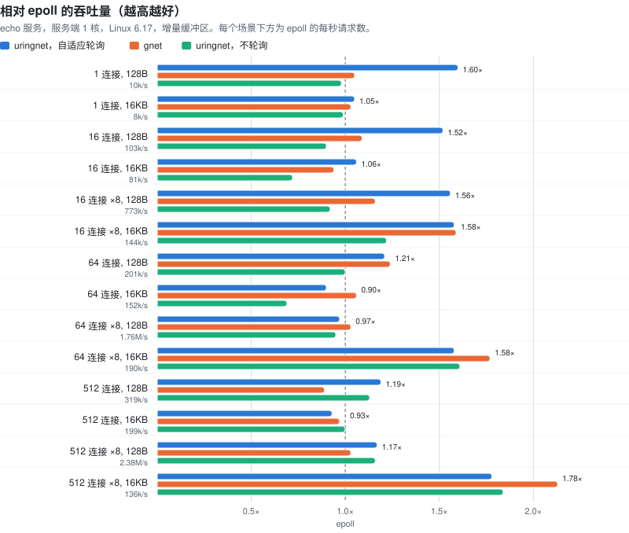
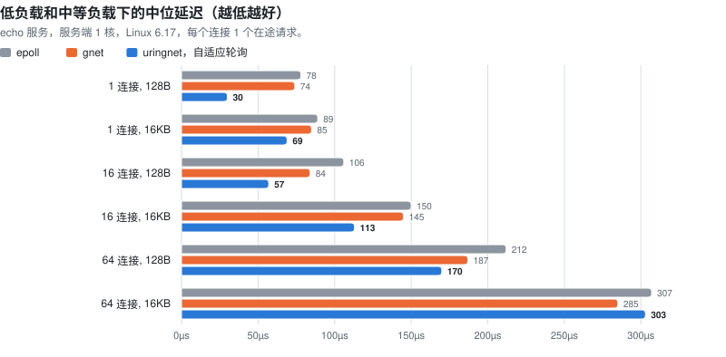

<h1 align="center">
  <picture>
    <source media="(prefers-color-scheme: dark)" srcset="docs/images/logo_dark.svg">
    
  </picture>
</h1>

<p align="center">
  <a href="https://github.com/y001j/uringnet/actions/workflows/go.yml"></a>
  <a href="https://codecov.io/gh/y001j/uringnet"></a>
  <a href="https://pkg.go.dev/github.com/y001j/uringnet"></a>
  <a href="go.mod"></a>
  <a href="LICENSE"></a>
</p>

<p align="center"><a href="README.md">English</a> | 中文</p>

## 简介

### 为什么做这个项目

UringNet 是一个用 Go 编写的轻量级网络 I/O 框架，基于 Linux 在 5.1（2019 年）中加入的异步 I/O 接口 [io_uring](https://kernel.dk/io_uring.pdf)。它源自我在边缘计算和物联网研究中的实验项目：我想在物联网网关里用一种简单而高效的方式收发网络数据包，先试了 select/epoll，后来又试了 io_uring。

在 Linux 6.17 上，使用推荐配置（增量缓冲区 + 自适应忙轮询，见[性能测试](#性能测试)），与手写的 epoll 循环和 [gnet](https://github.com/panjf2000/gnet) 对比：

- **低负载**（1–16 个连接）：小消息的吞吐量是 epoll 的 1.5–1.6 倍，中位延迟从约 78µs 降到约 30µs。代价是 CPU：负载最低时服务端 CPU 约为原来的两倍。
- **多连接、小消息**（512 个连接，128B）：是 epoll 的 1.17–1.19 倍，领先 gnet 14–34%。
- **中高负载下的 16KB 消息**：gnet 仍领先 12–20%（批量流水线传输：uringnet 是 epoll 的 1.58–1.78 倍，gnet 是 1.77–2.13 倍）。
- 总体来看，14 个场景中 uringnet 有 6 个领先 gnet 超过 10%，5 个相差在 ±10% 以内，3 个落后。
- 在较旧的内核（6.10）上且不开忙轮询时，uringnet 大多落后 epoll 10–30%。

io_uring 带来的是少得多的系统调用（高负载下每个请求低至 0.04 次，epoll 为 2–3 次）、批量提交，以及大块数据的零拷贝发送。收益很大程度上取决于负载类型和机器，请用你自己的流量实测。

#### io_uring 的工作原理


应用和内核共享两个环形缓冲区，这块内存同时映射到双方的地址空间。应用在提交队列的尾部写入请求（SQE），内核从头部取走；内核在完成队列的尾部写入结果（CQE），应用从头部取走。这两步都不需要系统调用：一次 `io_uring_enter` 就能提交一整批请求，并等待一批结果。

### 是否适合你的项目

UringNet 是为物联网网关设计的：连接多、消息小、请求/响应式的流量。它支持 TCP、Unix 流式套接字和 UDP（暂不支持 TLS），以及拨出连接和消息分帧。满足以下条件时可以考虑使用：

- 运行 Linux 6.0+（recv bundle 需要 6.16+），并且主机允许使用 io_uring（Docker 和 Kubernetes 默认的 seccomp 配置会禁用它）；
- 你在意延迟或系统调用开销，并且能为忙轮询留出一些 CPU。

否则，更成熟的方案如 Go 的 [net](https://golang.org/pkg/net/)/[http](https://pkg.go.dev/net/http)、[gnet](https://github.com/panjf2000/gnet)、[netty](https://netty.io/) 或 [libuv](https://github.com/libuv/libuv) 是更稳妥的选择。它们支持更多平台和内核，并且已经在生产环境中运行多年。

## 快速开始

UringNet 大量参考了 gnet、Netty 等现有网络框架，部分用法与 gnet 非常接近。请注意，UringNet 基于 io_uring，因此必须运行在 Linux 上，内核版本 **6.0 或更高**（需要 multishot recv / provided buffer ring；6.1+ 还会启用 `SINGLE_ISSUER | DEFER_TASKRUN`）。

从这个版本起，事件循环基于 [iouring-go](https://github.com/y001j/iouring-go) 的 `Loop` API 构建：每个 ring 一个 io_uring 和一个锁定的系统线程，使用 multishot accept/recv 和 provided buffer ring，每轮循环只调用一次 `io_uring_enter`。

### 安装 UringNet

```shell
go get -u github.com/y001j/uringnet
```

### echo 服务示例

```go
package main

import (
	"context"
	"os"
	"os/signal"
	"syscall"
	"time"

	"github.com/y001j/uringnet"
)

type echo struct{ uringnet.BuiltinHandler }

// 每次收到数据时，OnTraffic 在该连接所属的事件循环线程上运行。
// data 只在回调期间有效。把它原样写回时直接从接收缓冲区发送，不拷贝。
func (echo) OnTraffic(c *uringnet.Conn, data []byte) uringnet.Action {
	c.Write(data)
	return uringnet.None
}

func main() {
	srv, err := uringnet.Listen("tcp", ":8080", echo{},
		uringnet.WithBuffers(256, 16<<10), // 每个 ring 256 个 16KB 的接收缓冲区
		uringnet.WithIdleTimeout(5*time.Minute),
	)
	if err != nil {
		panic(err)
	}
	go func() {
		sig := make(chan os.Signal, 1)
		signal.Notify(sig, syscall.SIGINT, syscall.SIGTERM)
		<-sig
		ctx, cancel := context.WithTimeout(context.Background(), 5*time.Second)
		defer cancel()
		srv.Shutdown(ctx) // 不再接受新连接，已写入的数据发完后关闭连接
	}()
	srv.Serve() // Shutdown 之后返回 uringnet.ErrServerClosed
}
```

### 主要 API

**Server**

| API | 说明 |
|---|---|
| `Listen(network, address, handler, opts...)` | 在 `tcp`、`tcp4`、`tcp6` 或 `unix` 上创建服务；调用 `Serve` 后开始接受连接 |
| `Server.Serve()` | 运行服务直到关闭；返回 `ErrServerClosed` |
| `Server.Shutdown(ctx)` | 优雅关闭：停止接受新连接，每个连接把已写入的数据发完后关闭；`ctx` 结束时仍未关闭的连接立即关闭 |
| `Server.Close()` | 立即关闭所有连接和事件循环 |
| `Server.Addr()` / `Connections()` | 监听地址（`:0` 时为实际端口）/ 当前连接数 |
| `Server.Stats()` | 运行指标：接受的连接数、收发字节数、超时、accept 失败、接收缓冲区耗尽、背压暂停、零拷贝发送次数。可以用 `expvar.Func` 或任意指标库发布 |

**选项**

| 选项 | 说明 |
|---|---|
| `WithRings(n)` | 事件循环数量，每个有自己的 io_uring 和锁定的系统线程（默认 `runtime.NumCPU()`） |
| `WithBuffers(count, size)` | 每个 ring 的接收缓冲区：`count` 个（向上取整为 2 的幂，默认 256），每个 `size` 字节（默认 16KB）。见下文*接收缓冲区的数量* |
| `WithSQSize(n)` | 每个 ring 的提交队列大小（默认 512；完成队列是它的 4 倍）。见*已知问题*中关于锁定内存的说明 |
| `WithBusyPoll(d)` | 阻塞前先忙轮询 `d`（如 `50*time.Microsecond`）：以 CPU 换取更低的延迟。自适应：循环满载时自动停止 |
| `WithBusyPollThresholds(busy, idle)` / `WithBusyPollFixed(d)` | 调整自适应轮询的阈值（默认每轮 128 / 64 个完成事件）/ 始终轮询 |
| `WithZeroCopy(threshold)` | 不少于 `threshold` 字节的写入使用 `IORING_OP_SEND_ZC` 发送，见下文 |
| `WithRecvBundle(mode)` | recv bundle；`BundleAuto`（默认）只在 Linux 6.16+ 上启用，见下文 |
| `WithIncrementalBuffers()` | **实验性**：增量缓冲区 ring（Linux 6.12+），配合 `WithBuffers(32, 64<<10)` 效果最好，见下文 |
| `WithMaxWriteBuffer(n)` | 每个连接发送队列的上限（默认 4MB，负数表示不限制）。超过时暂停接收该连接的数据（不再调用 `OnTraffic`），队列降到一半以下后恢复，这样不读数据的对端不会让服务端无限缓存 |
| `WithIdleTimeout(d)` | 连接在 `d` 内既没收到也没发出数据就关闭 |
| `WithWriteTimeout(d)` | 发送队列在 `d` 内没有任何进展（例如对端不再读取）就关闭连接 |
| `WithReusePort(on)` / `WithTCPNoDelay(on)` | 每个 ring 一个开启 `SO_REUSEPORT` 的监听套接字（默认开启）/ `TCP_NODELAY`（默认开启） |
| `WithLogger(*slog.Logger)` | 输出服务能自行恢复的异常（accept 失败、零拷贝回退）的警告，以及超时等调试信息；默认不输出 |

**Handler 和 Conn**

| API | 说明 |
|---|---|
| `OnBoot(s)` / `OnShutdown(s)` | 开始服务时调用一次 / 全部关闭后调用一次 |
| `OnOpen(c) Action` | 接受了一个连接 |
| `OnTraffic(c, data) Action` | 收到数据；`data` 只在回调期间有效 |
| `OnClose(c, err)` | 每个连接恰好调用一次。`err` 为 `nil`（你主动关闭）、`io.EOF`（对端关闭）、`ErrIdleTimeout`、`ErrWriteTimeout`、`ErrServerClosed`，或套接字错误 |
| `Conn.Write(b)` | 把 `b` 加入发送队列。会拷贝，除非 `b` 位于本次的 `data` 中，此时原地发送 |
| `Conn.WriteNoCopy(b, release)` | 不拷贝地加入发送队列；内核不再使用 `b` 后调用 `release` |
| `Conn.Close()` | 已写入的数据发完后关闭连接 |
| `Conn.AsyncWrite(b, done)` / `AsyncClose()` | 同上，可在任意 goroutine 中调用 |
| `Conn.Context()` / `SetContext(v)` | 连接级的状态 |
| `Conn.RemoteAddr()` / `LocalAddr()` / `Fd()` / `Buffered()` | 地址、套接字 fd、排队待发的字节数 |

返回的动作：`None`、`Close`（等同于 `Conn.Close`）、`Shutdown`（关闭整个服务）。

回调的语义：

- 所有回调都在连接所属的事件循环线程上运行，不能阻塞。要从其他 goroutine 回复数据，用 `AsyncWrite`。
- 同一连接上的写入保持顺序，并会处理部分写入。一次回调中写入的数据会在回调返回后一起发送，多个独立的数据段（例如 `WriteNoCopy` 的数据加上头部）通过一次 `sendmsg` 发出。
- 对端关闭写方向（半关闭）后，已写入的数据仍会发完再关闭连接。

旧的 API（`NewMany`、`SetLoops`、`EventHandler`、`UserData`）仍然可用，但已标记为弃用。

### 拨出连接

`Server.Dial(ctx, network, address, connCtx)` 从服务的某个事件循环发起连接（使用 `IORING_OP_CONNECT`），在 `OnOpen`
执行完后返回 `*Conn`；`connCtx` 会在 `OnOpen` 之前设为连接的 Context，回调里据此可以区分拨出的连接。`Dial` 会阻塞，
在回调中请用 `DialAsync`，结果通过事件循环上的回调返回。`Conn.DialAsync` 在已有连接所在的同一个事件循环上拨号，
两个连接可以在回调中直接互相写入，代理需要的就是这个（见 `ExampleConn_DialAsync`）。只拨号、不监听的程序用
`NewClient(handler, opts...)`。

### 分帧（编解码）

`Framed(framer, handler)` 把字节流切成消息：每个完整的帧调用一次 `OnMessage(c, msg)`。完整到达的帧直接把接收缓冲区
交给回调（原样写回就是原地发送）；不完整的帧按连接缓存，等后续数据到齐。内置 `NewLengthField(头部字节数, 字节序, 最大负载)`、
`NewDelimiter(分隔符, 最大帧长)` 和 `FixedLength(n)`，都可以用 `AppendFrame` 构造要发送的帧；其他格式实现 `Framer` 接口即可。
超长的帧会以 `ErrFrameTooLarge` 关闭连接。

```go
framer := uringnet.NewLengthField(2, binary.BigEndian, 64<<10)
srv, err := uringnet.Listen("tcp", ":9000", uringnet.Framed(framer, handler)) // handler 实现 OnMessage
```

### UDP

`ListenPacket("udp", address, handler, opts...)` 为每个 ring 打开一个开启 `SO_REUSEPORT` 的 socket，用 multishot `recvmsg`
接收到 provided buffer ring。`OnPacket(pc, data, from)` 收到的来源地址是 `netip.AddrPort`，接收过程不分配内存；用
`pc.WriteTo` 回复，或在任意 goroutine 中用 `AsyncWriteTo` 发送。接收缓冲区要能放下整个数据报再加约 48 字节，更大的数据报
会被丢弃并计入 `Stats.PacketsTruncated`。绑定端口 0 并用 `Start` 启动时，`PacketServer` 也可以当作 UDP 客户端使用。

### 接收缓冲区的数量

每个 ring 把数据接收到一个由 `bufferCount` 个、每个 `BufferSize` 字节的缓冲区组成的池中（provided buffer ring）。

- **不少于同一个 ring 上同时活跃的连接数。** 缓冲区用完时，内核会以 `-ENOBUFS` 结束该连接的 multishot recv，必须重新提交，这比一次拷贝的开销大得多。
- **在此前提下越少越好。** 内核按 FIFO 顺序使用缓冲区，所以整个池都是工作集。池越小，内核拷贝的目标内存越容易留在 CPU 缓存中。在性能测试中，每个连接 8 个请求在途、16KB 消息时，64 个缓冲区比 1024 个快约 1.5 倍。
- `256`（示例中的值）是一个合理的默认值。每个 ring 上繁忙连接很多时用更多，连接少且以批量传输为主时用更少。

### Recv bundle

使用 `IORING_RECVSEND_BUNDLE` 时，一次 multishot recv 的完成事件可以填满多个连续的接收缓冲区，因此积压在套接字里的数据只产生一个完成事件，而不是每个缓冲区一个。每个缓冲区仍然分别交给 `OnTraffic`。在 Linux 6.17 上的性能测试中，bundle 让流水线 16KB echo 提升了 6–13%。

内核 6.10–6.15 存在缺陷，使用 bundle 时**接收到的数据可能出现空洞**（上游已修复：6.15 中的 `3a08988123c8`，以及 6.16 中的 `26ec15e4b0c1`/`178b8ff66ff8`，都已标记回合到 stable 分支）。我们在 6.10 上复现了数据损坏，并在 6.17 上验证了数据正确。因此 `BundleAuto` 只在 6.16+ 上启用 bundle。`BundleOn` 强制启用（仅当你确定内核已包含这些修复时使用），`BundleOff` 关闭。

### 增量缓冲区（实验性）

`IncrementalBuffers = true` 会以 `IOU_PBUF_RING_INC` 注册接收 ring（Linux 6.12+）。内核不再为每次接收占用一整个缓冲区，而是把每次接收的数据追加到同一个缓冲区中上一段数据之后，于是少量大缓冲区就能装下来自许多连接的数据。每次原地发送引用缓冲区中的一段；当内核已填满某个缓冲区、并且没有任何片段仍被引用时，该缓冲区才归还给内核。由于被引用的缓冲区仍然可以继续接收数据，一个连接可以原地发送多个接收到的片段，从而避免了大部分用户态拷贝。

```go
srv, err := uringnet.Listen("tcp", ":8080", handler,
	uringnet.WithIncrementalBuffers(),
	uringnet.WithBuffers(32, 64<<10)) // 每个 ring 32 x 64KB
```

- 在 Linux 6.17 的性能测试中，这是 uringnet 最快的配置：512 个连接时领先 gnet（小消息领先约 15%），批量流水线传输时与 gnet 相差 5–10%（见[性能测试](#性能测试)）。
- 至少使用 32 个缓冲区：只有 16 个时，512 个连接各发 16KB 会耗尽缓冲区并变慢。
- 这种模式下不使用 recv bundle。内核不支持时会回退到普通的缓冲区 ring。
- 这是新代码，默认关闭；在生产环境启用前，请先用你自己的流量验证。

### 零拷贝发送

使用 `WithZeroCopy(threshold)` 时，接收缓冲区 ring 还会注册为 io_uring 的 *fixed buffer*（`IORING_REGISTER_BUFFERS`）。这块内存由用户态和内核共享：

```
          内核把数据接收到这里                  内核直接从这里发送
 NIC/TCP ───────────────────────►  缓冲区 ring（固定在内存中，只映射一次） ───────────────────► NIC/TCP
          (provided buffers)          ▲ OnTraffic 原地看到 data              (SEND_ZC + FIXED_BUF)
                                      │ 不拷贝
```

- Echo/转发（在 `OnTraffic` 中 `c.Write(data)`）：数据直接从接收缓冲区本身用 `SendZCFixed` 发出；缓冲区要等到内核的通知 CQE（`IORING_CQE_F_NOTIF`）之后才回到 ring。
- 你自己持有的大块响应（缓存的文件、预先构造的数据）：`c.WriteNoCopy(b, release)` 用 `SEND_ZC` 发送 `b`，不把它拷贝进套接字缓冲区。
- 仍然存在的拷贝：接收方向上，数据仍要从套接字拷贝到缓冲区 ring。要去掉这次拷贝需要 io_uring 零拷贝接收（zcrx，`IORING_OP_RECV_ZC`，Linux 6.15+），它需要网卡支持（header split、flow steering、专用的接收队列），目前没有实现。
- 在真实硬件上的预期：跨机器、使用真实网卡时，零拷贝发送应能降低大块发送（大约 10KB 以上）的 CPU 占用，因为内核不再把数据拷贝进套接字缓冲区，网卡直接从缓冲区发送。这一点还没有实测（见*性能测试*），小消息不会受益。
- 注意事项：只有每次发送大约 10KB 以上才划算；**发往本机套接字的流量（loopback、同一主机上的容器）总是会被内核拷贝**，所以在这种情况下反而更慢；固定在内存中的页会计入 `RLIMIT_MEMLOCK`。注册失败时，uringnet 回退到普通的 `SEND_ZC`。`SEND_ZC` 因 `ENOMEM`/`EOPNOTSUPP` 失败时，回退到普通发送。

### 在 macOS 上测试

```shell
docker run --rm --security-opt seccomp=unconfined -v "$PWD":/src -w /src golang:1.22 go test -race .
```

必须加 `seccomp=unconfined`，因为 Docker 默认的 seccomp 配置会禁用 io_uring。

## 性能测试

### 测试方法

- **负载**：echo。一个客户端保持 `c` 个连接（1、16、64、512）。在每个连接上写入 `p` 个 `s` 字节的请求（请求/响应式时 `p` = 1，流水线时为 8；`s` = 128B 或 16KB），然后读回所有响应，如此循环。
- **对比的服务端**：手写的 **epoll** 循环（每核一个锁定线程，`SO_REUSEPORT`，非阻塞读写）、[**gnet**](https://github.com/panjf2000/gnet) v2 和 **uringnet**。三者运行相同的 echo 逻辑。
- **服务端受限的设置**：服务端绑定到 **1 个核**（`taskset`、`GOMAXPROCS=1`、一个事件循环），客户端使用其余的核，通过 loopback 通信。每个场景运行 3 次，每次 3 秒；表中为中位数。
- **指标**：吞吐量（每秒请求数，以相对 epoll 的倍数表示）、中位延迟（p50，由客户端采样）、服务端 CPU（来自 `/proc`）。
- **环境**：Apple Silicon Mac 上的 Lima 虚拟机（Apple Virtualization.framework），Ubuntu 25.10，**Linux 6.17**，4 个 vCPU（服务端 1 核，客户端 3 核）。另附 Linux 6.10 的 Docker Desktop 虚拟机结果作为参考。
- **工具**：全部在 [`bench/`](bench/README.md) 中，见下文*复现测试*。

### 结果：推荐配置（Linux 6.17）

<picture>
  <source media="(prefers-color-scheme: dark)" srcset="docs/images/bench_throughput_zh_dark.svg">
  
</picture>

uringnet 使用增量缓冲区（每个 ring 32 x 64KB）。吞吐量为相对 epoll 的倍数；**粗体** = 最快。

| 连接数, 在途请求数, 消息大小 | epoll | gnet | uringnet，不轮询 | uringnet，始终轮询 | uringnet，自适应轮询 |
|---|---|---|---|---|---|
| 1, 1, 128B | 10k/s | 1.05 | 0.98 | **1.67** | 1.60 |
| 1, 1, 16KB | 8k/s | 1.03 | 0.99 | **1.07** | 1.05 |
| 16, 1, 128B | 103k/s | 1.09 | 0.90 | 1.45 | **1.52** |
| 16, 1, 16KB | 81k/s | 0.94 | 0.72 | **1.12** | 1.06 |
| 16, 8, 128B | 773k/s | 1.16 | 0.92 | **1.59** | 1.56 |
| 16, 8, 16KB | 144k/s | **1.59** | 1.22 | 1.41 | 1.58 |
| 64, 1, 128B | 201k/s | 1.24 | 1.00 | **1.26** | 1.21 |
| 64, 1, 16KB | 152k/s | **1.06** | 0.69 | 0.90 | 0.90 |
| 64, 8, 128B | 1.76M/s | 1.03 | 0.95 | **1.05** | 0.97 |
| 64, 8, 16KB | 190k/s | **1.77** | 1.61 | 1.61 | 1.58 |
| 512, 1, 128B | 319k/s | 0.89 | 1.13 | 1.13 | **1.19** |
| 512, 1, 16KB | 199k/s | 0.97 | **1.00** | 0.81 | 0.93 |
| 512, 8, 128B | 2.38M/s | 1.03 | 1.16 | **1.17** | **1.17** |
| 512, 8, 16KB | 136k/s | **2.13** | 1.84 | 1.87 | 1.78 |

中位延迟 / 服务端 CPU：

<picture>
  <source media="(prefers-color-scheme: dark)" srcset="docs/images/bench_latency_zh_dark.svg">
  
</picture>

| 连接数, 在途请求数, 消息大小 | epoll | gnet | uringnet，不轮询 | uringnet，自适应轮询 |
|---|---|---|---|---|
| 1, 1, 128B | 78µs / 27% | 74µs / 25% | 78µs / 30% | **30µs** / 68% |
| 1, 1, 16KB | 89µs / 28% | 85µs / 26% | 100µs / 31% | **69µs** / 60% |
| 16, 1, 128B | 106µs / 63% | 84µs / 59% | 120µs / 56% | **57µs** / 81% |
| 16, 1, 16KB | 150µs / 71% | 145µs / 63% | 208µs / 66% | **113µs** / 81% |
| 16, 8, 16KB | 732µs / 88% | 456µs / 85% | 584µs / 78% | **406µs** / 87% |
| 64, 1, 128B | 212µs / 80% | 187µs / 86% | 216µs / 78% | **170µs** / 85% |
| 64, 1, 16KB | 307µs / 85% | **285µs** / 85% | 420µs / 77% | 303µs / 87% |
| 64, 8, 16KB | 2.42ms / 93% | **1.30ms** / 92% | 1.34ms / 92% | 1.32ms / 96% |
| 512, 1, 128B | 1.34ms / 97% | 1.43ms / 97% | 1.16ms / 95% | **1.10ms** / 94% |
| 512, 1, 16KB | 2.29ms / 98% | 2.33ms / 98% | **2.26ms** / 97% | 2.43ms / 95% |
| 512, 8, 16KB | 27.3ms / 97% | **13.0ms** / 97% | 13.2ms / 99% | 13.3ms / 99% |

### 结果：默认配置与增量缓冲区对比（Linux 6.17）

默认 = recv bundle + 64 x 16KB 缓冲区；增量 = 32 x 64KB。两者都不轮询。

| 连接数, 在途请求数, 消息大小 | epoll | gnet | uringnet，默认 | uringnet，增量 |
|---|---|---|---|---|
| 64, 1, 128B | 197k/s | 1.16 | 1.10 | **1.19** |
| 64, 1, 16KB | 152k/s | **1.04** | 0.93 | 0.92 |
| 64, 8, 128B | 1.69M/s | **1.14** | 1.01 | 1.09 |
| 64, 8, 16KB | 205k/s | **1.68** | 1.51 | 1.60 |
| 512, 1, 128B | 340k/s | 0.99 | 0.97 | **1.16** |
| 512, 1, 16KB | 215k/s | 0.99 | 0.96 | **1.05** |
| 512, 8, 128B | 2.66M/s | 1.00 | 0.96 | **1.14** |
| 512, 8, 16KB | 172k/s | **1.75** | 1.52 | 1.57 |

512 个连接、8 个在途请求、16KB 时的中位延迟：epoll 23.3ms，gnet 12.3ms，默认 22.4ms，增量 **10.9ms**。

### 结果：较旧的内核（Linux 6.10，仅供参考）

Docker Desktop 虚拟机，服务端 1 核，客户端 8 核。Linux 6.10 不支持增量缓冲区，recv bundle 默认也是关闭的。使用较早版本的代码测得（在批量发送和自适应轮询之前），不轮询。

| 连接数, 在途请求数, 消息大小 | epoll | gnet | uringnet |
|---|---|---|---|
| 64, 1, 128B | 226k/s | **1.01** | 0.78 |
| 64, 1, 16KB | 176k/s | **1.04** | 0.68 |
| 64, 8, 128B | 1.88M/s | **1.03** | 0.67 |
| 64, 8, 16KB | 264k/s | **1.56** | 1.29 |
| 512, 1, 128B | 421k/s | **0.99** | 0.91 |
| 512, 1, 16KB | 257k/s | **0.98** | 0.78 |
| 512, 8, 128B | 3.27M/s | **0.98** | 0.89 |
| 512, 8, 16KB | 194k/s | **1.69** | 1.54 |

### 与 gnet 的对比

Linux 6.17 上使用推荐配置（上表中的自适应轮询一列）：

| | 场景 |
|---|---|
| uringnet 领先超过 10%（6 个） | 1 连接 128B（+52%）、16 连接 128B（+39%）、16 连接 16KB（+13%）、16 连接 x8 128B（+34%）、512 连接 128B（+34%）、512 连接 x8 128B（+14%） |
| 相差在 ±10% 以内（5 个） | 1 连接 16KB、16 连接 x8 16KB、64 连接 128B、64 连接 x8 128B、512 连接 16KB |
| gnet 领先超过 10%（3 个） | 64 连接 16KB（+18%）、64 连接 x8 16KB（+12%）、512 连接 x8 16KB（+20%） |

两种设计为什么在不同场景下各有胜负：

- **uringnet**：系统调用少得多（高负载下每个请求低至 0.04 次，epoll 为 2–3 次），并且批量提交。开启忙轮询后，事件循环避免了睡眠/唤醒的循环，而低负载时延迟主要就耗在这上面。
- **gnet**：每个连接最多一次读取 64KB，读到一个始终留在 CPU 缓存中的缓冲区里，并且只在事件循环轮到该连接时才读取。io_uring 的 provided buffer 则是数据一到就由内核填充，因此数据被拷贝到较冷的内存中，也需要缓冲更多数据。这使 gnet 在批量传输中占优。不过它在这些场景下的吞吐量部分是以公平性为代价的：在早先的测试中，它的 p99 延迟为 450–580ms，而 uringnet 为 40–90ms。

### 结论

1. 在较新的内核（6.17）上，使用增量缓冲区和自适应轮询时，uringnet 在 14 个场景中有 11 个持平或超过 gnet。领先最多的是低负载（最高达 gnet 的 1.5 倍，中位延迟约为 gnet 的 40%）以及多连接小消息的场景。
2. 中高负载下的 16KB 消息仍是 gnet 更好，尤其是批量流水线传输（12–20%）。
3. 忙轮询是用 CPU 换延迟：低负载时服务端 CPU 约为原来的两倍。自适应轮询在满负载时会关闭轮询，而始终轮询在满负载时最多会损失约 20% 的吞吐量（512 个连接、16KB：epoll 的 0.81 倍对比 0.93 倍）。
4. 内核版本很重要：在 6.10 上不轮询时，uringnet 大多落后 epoll 10–30%。
5. 零拷贝发送没有测量：发往本机套接字的数据总是会被内核拷贝，所以需要两台机器和真实网卡才能测。在真实硬件上，它预计能通过去掉拷贝进套接字缓冲区这一步来改善批量传输（大约 10KB 以上的发送），而这正是 gnet 目前领先的场景；小消息不会受益。下一步就是测量这一点。

### 注意事项

- 这些是虚拟机中的 loopback 数据。在虚拟机里唤醒一个空闲的 vCPU 开销很大，这比在物理机上更有利于忙轮询。
- 不同次运行之间结果相差 5–15%，批量流水线传输的波动更大（gnet 在不同次运行中测得 epoll 的 1.75–2.13 倍）。相差不到 10% 应视为持平。
- 6.17 虚拟机只有 3 个客户端核，高并发下的差距可能被压缩。
- 6.10 的结果来自较早版本的代码。

### 复现测试

做决定之前，请在你自己的硬件上、用你自己的流量测量：

```shell
bench/docker.sh                               # 在 Docker 中运行，服务端 4 核 / 客户端 4 核
MODE=onecore DEPTHS="1 8" bench/docker.sh     # 服务端 1 核 / 客户端 8 核
sh bench/scripts/run.sh                       # 直接在 Linux 机器上运行（需要 taskset 和 12 个 CPU）
```

跨两台机器、通过真实网卡测试（要看到零拷贝发送的效果必须这样测）：

```shell
sh bench/scripts/serve.sh                              # 在服务端机器上
SERVER=<服务端 IP> sh bench/scripts/remote.sh > r.txt  # 在客户端机器上（Linux 或 macOS）
python3 bench/scripts/summarize.py r.txt epoll
```

`serve.sh` 会启动各个 echo 服务端，以及一个向客户端报告端口和 CPU 时间的小代理程序；在 16KB 和 64KB 下比较 `uringnet-best` 与 `uringnet-best-zc`。详见 [bench/README.md](bench/README.md#跨机器压测)。

用 `SERVERS="epoll gnet uringnet uringnet-inc uringnet-spin"` 选择要测的服务端；`servers/uringnet` 支持 `-inc`、`-spin`、`-spinfixed`、`-bufs`、`-bufsize` 等参数（见 [bench/README.md](bench/README.md)）。

上面的图表（中英文两套）由 `python3 bench/scripts/charts.py` 根据结果表生成（无需任何依赖）；有新的测量结果时，修改该脚本顶部的数据后重新运行即可。

## 已知问题

> **警告：** 本项目仍在开发中。如果发现任何问题或有任何建议，欢迎提交 issue。

- 需要 Linux 6.0+ 并启用 io_uring。Docker 默认的 seccomp 配置和 Kubernetes 的 `RuntimeDefault` 会禁用 io_uring，Linux 6.6+ 还可以通过 `kernel.io_uring_disabled` 关闭它。目前没有回退到 epoll 的机制。
- 对没有 `CAP_IPC_LOCK` 权限的进程，io_uring 的环形队列按用户计入 `RLIMIT_MEMLOCK`：默认 SQ 大小 512 时每个 ring 约 70KB
  （4096 时约 550KB），开启零拷贝时注册的接收缓冲区也计算在内。常见的 8MB 上限下大约能建 110 个 ring。如果 `Listen`
  报 “out of locked memory”，请调大 `ulimit -l`（systemd 服务用 `LimitMEMLOCK=`），或减少 ring 数量。
- 不支持 TLS。
- recv bundle 需要 Linux 6.16+ 才能保证数据正确（见 *Recv bundle*）。
- accept 失败（例如 `EMFILE`）时会按指数退避重试（5ms 起，最长 1s），并通过 `WithLogger` 输出日志。
